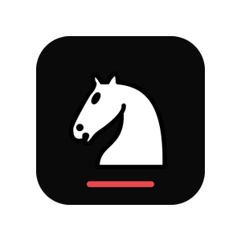
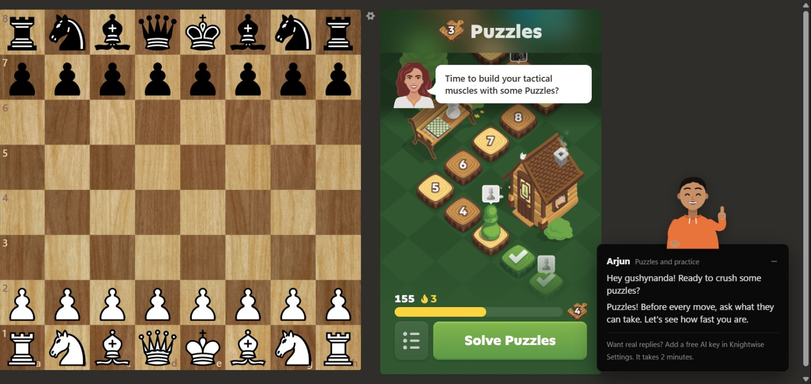
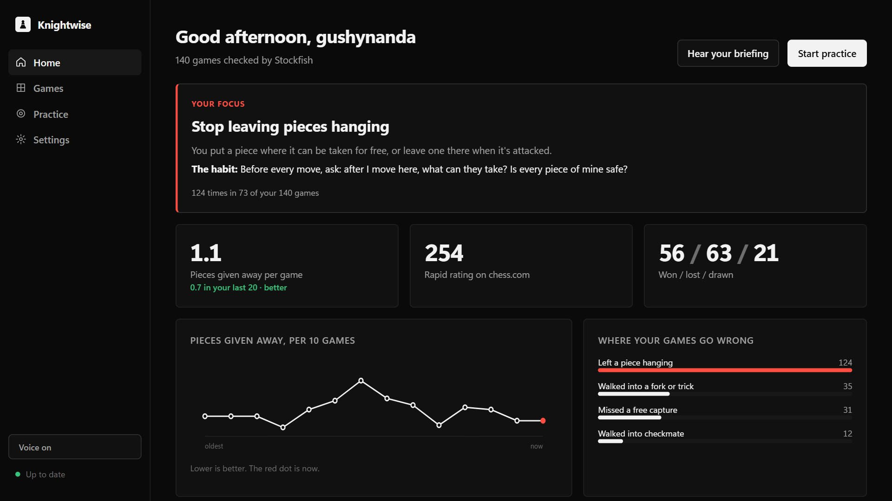
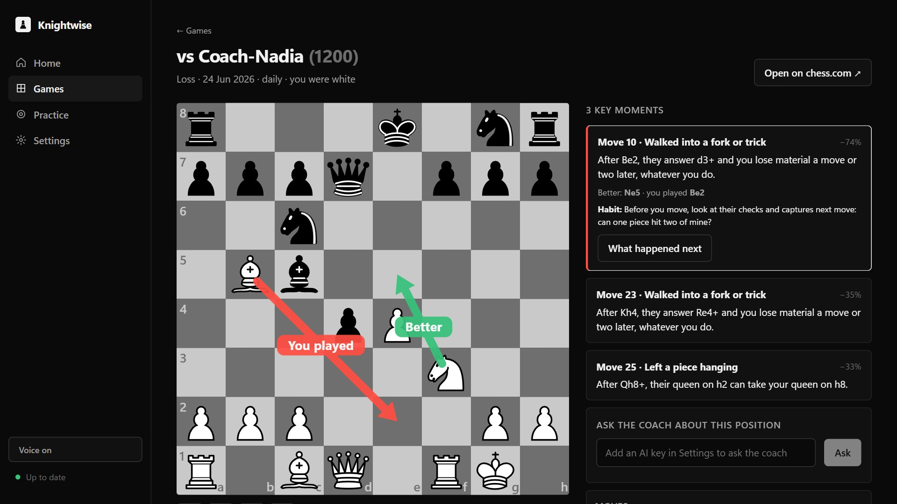
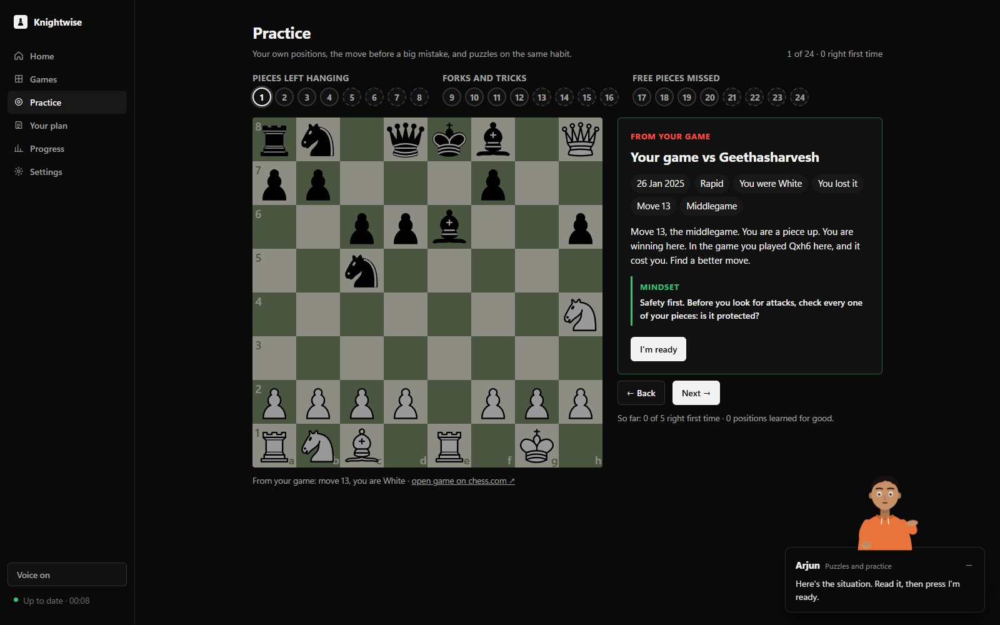
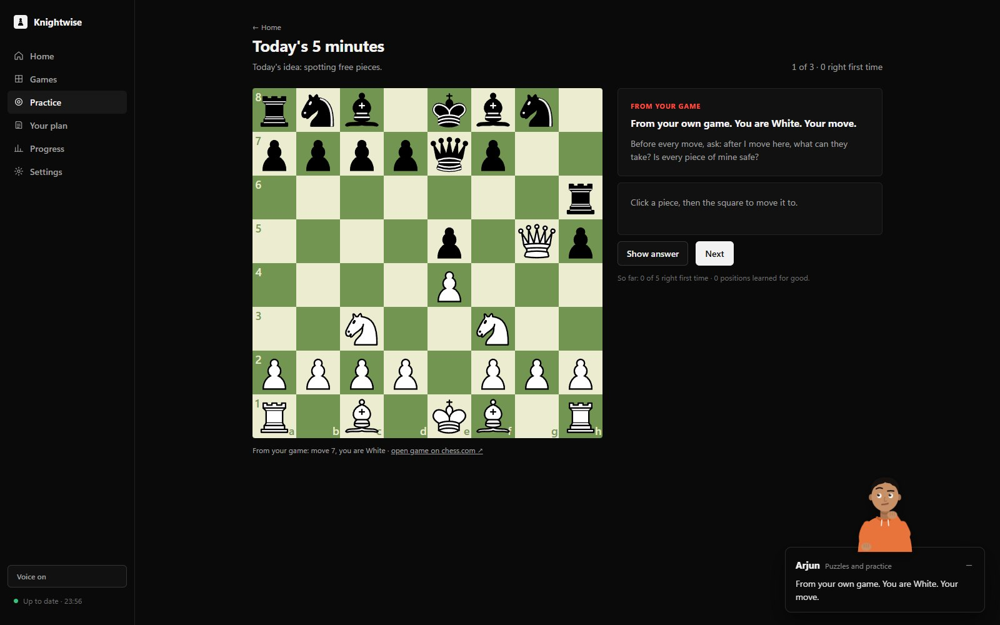
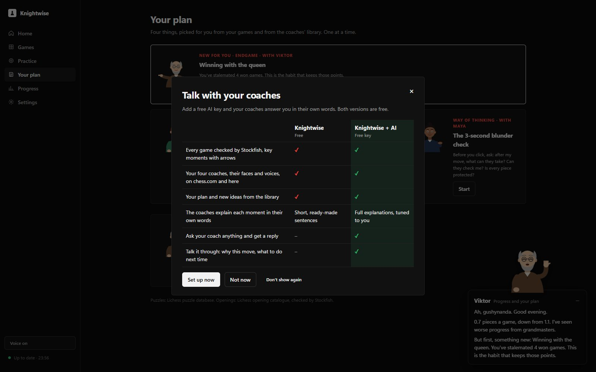
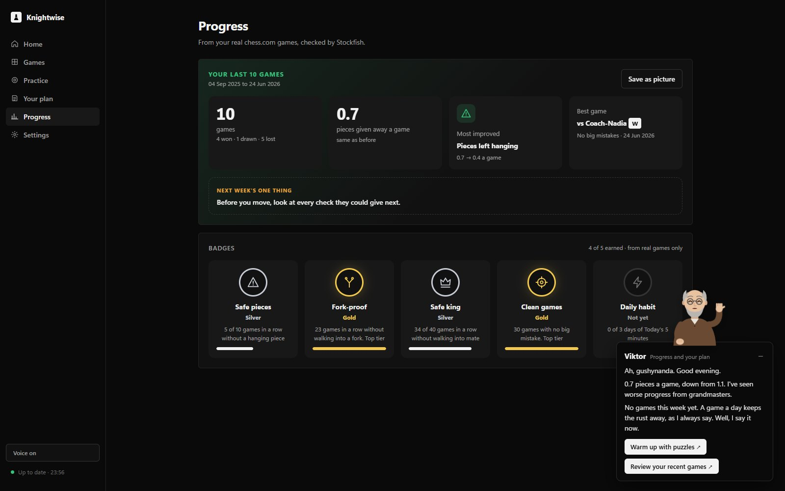
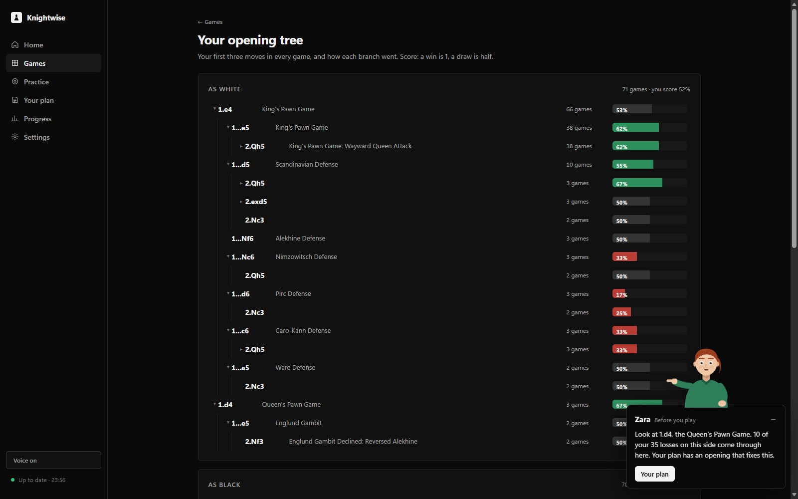
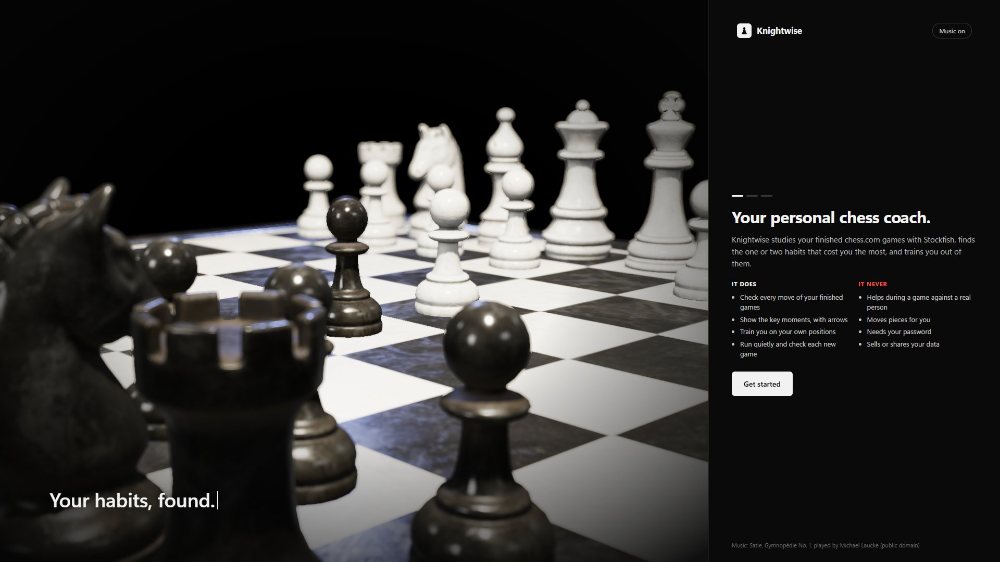

<div align="center">



# Knightwise

### A chess coach that sits beside you on chess.com.

It reads your real games, finds the habits that lose them, and trains you out of them,
one thing at a time, at your level. Free, open source, and it runs on your own PC.

**30,000 puzzles** · **3,865 named openings** · **every move you played checked by Stockfish** · **4 coaches with their own voices**

No account · no ads · no subscription · your games stay on your computer

*Microsoft Store: private beta now, public release coming. Windows 10 and 11.*

</div>



> **Fair play is built in, not bolted on.** During any game against a real person the coaches are gone:
> no hints, no arrows, nothing reads the board. They only work on finished games, puzzles, lessons and your own practice.

## What you get, free

| | |
|---|---|
| **Your games, checked move by move.** Every move you played on chess.com is checked by Stockfish. Knightwise sorts the mistakes into the habits behind them, like pieces left hanging or walking into forks, and counts them. |  |
| **Review with arrows, on chess.com itself.** Your key moments get labelled arrows: what you played, what was better and their reply, on your own board or on chess.com's. Then **Try it again** turns any of those moments into a puzzle. |  |
| **A briefing before every position.** Which game it's from, the phase, the material and what happened, then the mindset to bring. Practice is grouped by habit, with Back and Next, and puzzles at your level. |   |
| **Today's 5 minutes.** One position from your own games, one puzzle on today's idea and the first moves of your opening. The streak is gentle: one missed day is forgiven, and nobody scolds you. |  |
| **Four coaches, nothing to set up.** Maya reviews your games, Arjun runs puzzles and practice, Zara gets you ready to play, and Viktor tracks your progress. They are drawn characters with 12 gestures and moods: worried when you go wrong, cheering when you get it. They talk with their own voices, made on your PC. |  |
| **Progress you can see.** You vs you: your last 20 games against the 20 before. Viktor writes the story of your week, which you can save as a picture. 20 badges, Bronze to Gold, are earned only in real games and your own practice. |  |
| **Your opening tree.** Your first moves of every game as White and Black, with your score on each branch. A note marks the branch that costs you games, and your plan suggests an opening that suits you. |  |

**Something new, only when you need it.** The coaches bring a new tactic, opening or idea when your games
show a reason, like a stalemated win, a new kind of mistake or a losing streak, and one at a time.
The rest of the time they keep you on the one habit that matters most right now.

**Talk with your coaches, also free.** Add a free key from Google Gemini or Groq and they answer your
questions in their own words. The engine still decides every move; the AI only explains it. Without a key the
coaches use their written sentences, and if the AI is busy they still answer. The chat AI runs at the provider you pick, not on your PC.

## Honest numbers

From the developer's own 140 checked chess.com games, nothing hand-picked:

- **Pieces given away a game:** 1.2 in the 20 games before, then **0.7** in the last 20.
- **Games won:** 25% in the 20 games before, then **45%** in the last 20.
- **Losses by checkmate:** 35 of the first 63 losses ended in checkmate, which is why "check their checks" is one of the habits it trains.

Your numbers will be different. That's the point: everything is worked out from **your** games.

## How it works

1. **Type your chess.com username.** There's no password, because only your public games are read.
2. **Knightwise checks your games** with Stockfish on your PC, which takes about 2 minutes the first time, and keeps checking new ones by itself.
3. **Play on chess.com as usual.** After a game, the coaches show up with what mattered and what to practise next.



## What it doesn't do

- It never helps during a game against a real person, and it never moves pieces or clicks for you.
- It doesn't play against you; chess.com has bots for that.
- It needs Windows for the app. The chess.com coaches need Chrome or Edge with the Knightwise extension.

## Status: private beta

| Piece | State |
|---|---|
| Download a player's games from chess.com | works |
| Check every move with Stockfish and find the big mistakes | works |
| Sort mistakes into patterns (hanging pieces, missed captures, forks, missed mates, stalemated wins) | works |
| Review page: your top 3 patterns on real boards from your own games, in plain words | works |
| Practice page: positions from your own games, click your move, it says right or why not | works |
| Only new games are downloaded and checked (so it can later run by itself) | works |
| Runs by itself in the background: checks new games every 10 minutes, Windows notification | works |
| Browser extension: key moments of your finished games with labelled arrows (Better / You played / Reply) on the chess.com board; guided set-up with real Chrome screenshots (click spots circled) and copy buttons | works (beta) |
| Four coaches (original characters: Maya for reviews, Arjun for puzzles and practice, Zara before you play, Viktor for progress and your plan): drawn with arms and hands, 12 gestures (wave, point, explain, celebrate, warn, worried...), voice; on chess.com and inside the app, each tab's coach comes up by themselves; hidden on every chess.com page where a game can run | built, testing (next update) |
| Your plan: one opening that suits your games (Lichess opening catalogue + Stockfish + your results), one tactic and one endgame from 30,000 Lichess puzzles in 20 themes at your rating, one way of thinking; played on the board with the coach reacting to every move | built, testing (next update) |
| Something new when it's needed: the coaches bring a new tactic, opening or idea only when your games show a reason (a stalemated win, a new kind of mistake, opening trouble, a losing streak, a stuck habit), one at a time | built, testing (next update) |
| Do this, not that: e.g. "skip bullet for now: 2.0 pieces lost a game there, 0.6 in blitz", or a break after 3 losses in a row | built, testing (next update) |
| Instant review: a just-finished game is reviewed as soon as chess.com archives it | built, testing (next update) |
| Navigation guide: the coach rings chess.com's own link ("click Puzzles") and checks you got there; it never clicks for you | built, testing (next update) |
| Talk with your coaches: with your own free AI key, ask questions and get replies in each coach's personality; the engine's facts are checked, and if the AI is busy the coach still answers | built, testing (next update) |
| Home at a glance: your focus with a practise button, your habits as clickable tiles (each opens practice for that habit, with a fewer or more lately arrow), win bar, rating change; numbers roll up, lines draw themselves | built, testing (next update) |
| Today's 5 minutes: one position from your own games, one puzzle on today's idea, the first moves of your opening; a gentle streak that forgives one missed day | built, testing (next update) |
| You vs you: your last 20 games against the 20 before (pieces given away, games won, big mistakes) | built, testing (next update) |
| Progress with Viktor: the story of your week (games, pieces given away against the week before, most improved habit, best game, next week's one thing), saved as a picture to share | built, testing (next update) |
| 20 badges in four groups, Habits, Clean play, Results and Practice, Bronze, Silver and Gold, earned from real chess.com games and your own practice only | built, testing (next update) |
| A briefing before every position: which game or puzzle it is, the phase, the material, the engine's verdict, what happened, and the mindset to bring; the coach reads it out, then the board wakes up | built, testing (next update) |
| Practice organised by habit: numbered dots grouped by habit (green right, orange missed), Back and Next, your own positions first, then puzzles at your level from easy to hard | built, testing (next update) |
| Try it again: any key moment of a reviewed game opens as a puzzle on the board, with Maya; it joins your practice memory | built, testing (next update) |
| Your opening tree: your first three moves of every game as White and Black, your score on each branch, named from the Lichess catalogue, and a note on the branches that cost you games | built, testing (next update) |
| Sounds: moves, captures, check, right and wrong answers, a finished set (with confetti), a coach arriving; picked by a player from Kenney's CC0 packs; own switch in Settings, no background music | built, testing (next update) |
| Lichess puzzles matched to your habits, mixed into the practice page (new set every day) | works |
| Practice remembers you: missed positions come back the next day, right ones after 3, 7, 21, 60 days | works |
| "Is this you?" answer on the review page, saved in your logbook | works |
| Welcome screen: a short 3D film of an antique chess set (Poly Haven, CC0) replaying the Opera Game (high above, then beside the pieces with the background out of focus, then a slow orbit), typed lines, a quiet Satie piano piece (public domain, mute remembered), set-up steps in a black panel on the right; offline | works |
| Desktop app window: Home (your focus, score, trend, last game), Games, Practice, Settings; dark and light | works (beta) |
| Settings: chess.com account, theme, voice, two optional AI key slots kept in Windows Credential Manager | works (AI use: next) |
| The coach speaks (Kokoro, on this computer): briefing, key moments, practice feedback; 4 voices | works |
| AI explanations and "Ask the coach" with your own key (Gemini, Groq, Claude or OpenAI), grounded in engine facts | works (beta) |
| Ask the coach by voice: Talk button, Whisper on this computer (one-time 485 MB download in Settings) | works (beta) |
| Windows installer: Next, Next, Finish; icon by the clock; welcome page asks your chess.com name | works (beta, not yet published) |
| Microsoft Store package (MSIX, signed by Microsoft on upload, so Windows never blocks it): starts with Windows, notifications, extension copied to Documents\Knightwise | built, not yet submitted |

## For players: install

1. Get **Knightwise** from the Microsoft Store (now a private beta for a small group of testers; public later). Click **Get**: no installer, no Python, no admin rights, and Windows doesn't block it, because the Store
   signs it.
2. The app opens full screen on the welcome: type your chess.com username. The coach checks your games (about 2 minutes the first
   time) and shows your review. From then on it lives as a knight icon by the clock and checks each new game
   by itself.
3. Optional, 1 minute: **Arrows on chess.com** (in the icon's menu) walks you through adding the browser
   extension and turns green when it works.

Your data stays on your computer, in the app's own Store folder. Uninstall from Windows Settings like any app:
that removes your data too, and a reinstall starts fresh with the welcome screen (there are no accounts).
Privacy: [PRIVACY.md](PRIVACY.md). Knightwise is independent and not connected with chess.com.

## For developers: run from source (Windows, Python 3.12)

```
pip install -r requirements.txt
python -m coach.get_engine                       # downloads Stockfish (~80 MB) into engine/
python -m coach.get_voice                        # optional: speaking (~120 MB) and listening (~485 MB) into voice/
python -m coach.get_assets                       # the 3D welcome scene and music (~32 MB) into coach/ui/vendor/
python -m coach.puzzles                          # optional: Lichess puzzles (reads ~300 MB, keeps ~2.5 MB)
python -m coach.update <your chess.com username>
```

`update` downloads your games, checks every move you made with Stockfish (about 2 minutes for 150 games on
8 cores, the first time) and writes two pages to open in your browser: **`data/review.html`** and
**`data/drills.html`**. Run `python -m coach.update`
again after you play: it only downloads and checks the new games.

**Try the desktop app before a Store release:** double-click `try.bat` (your own games), or run `try fresh` to see
it as a brand-new player (welcome screen first; nothing is kept). It closes the Store copy first, because only one
Knightwise can run at a time.

The review page starts with **your last game** (result, pieces given away, its key moments on boards: this is
what the notification opens), then your score to bring down, **pieces given away per game** (all games, and your
last 20), then shows your top 3 mistake patterns, how often each happened, the habit that fixes it, and
3 real positions from your games for each: your move (red), what they could do next (orange), the better
move (green), with a link to the game on chess.com.

The practice page gives 12 other positions from your games, the move before a big mistake, mixed with 12
Lichess puzzles on the same habits (hanging pieces, forks, mate in 1 and 2; rated 400-1200; a new set every day).
Click a piece, then a square. In your own positions a safe move gets a yes and a bad one gets the reason
("then their bishop takes your queen on g7"); every legal move was scored by Stockfish when the page was built,
so the page needs no internet or engine. Opened through the coach (http://127.0.0.1:8765/practice) it keeps
your answers: a position you miss comes back the next day, one you get right comes back after longer and longer
gaps (1, 3, 7, 21, 60 days) until it sticks. In puzzles you see their last move (orange), then find yours; longer
puzzles answer and wait for your next move.

### Let it run by itself

```
python -m coach.autorun install      # starts with Windows, and starts now
python -m coach.autorun status
python -m coach.autorun remove       # stops it and removes it from Windows startup
```

It runs quietly in the background (no window). Every 10 minutes it looks for new finished games on chess.com,
checks them, rebuilds both pages and shows a Windows notification. Your pages are then at
**http://127.0.0.1:8765/** (review) and **http://127.0.0.1:8765/practice** (this computer only).
Its own log is `logbook/service.log`.

### Arrows on chess.com (browser extension, beta)

1. Keep the coach running (`python -m coach.autorun install`, or `python -m coach.service` in a terminal).
2. In Chrome go to `chrome://extensions` (Edge: `edge://extensions`), switch on **Developer mode**, click
   **Load unpacked** and choose the `extension` folder of this project.
3. Open one of your finished games on chess.com (`chess.com/game/live/...`). A small **Chess Coach** panel
   lists the key moments. Click one: the board jumps there and shows the better move (green) and your move
   (red). "What happened next" shows your move and their answer (orange). The – button shrinks the panel.
4. The Chess Coach button in the browser toolbar says whether the coach is running and links to your review
   and practice pages.

**Why no hints in chess.com bot games?** chess.com's fair-play rules forbid any tool that analyses positions during
play, with no exception for bot games. So the coach helps before and after games, never during one.

**Fair play:** the extension only shows something for games the coach already knows, and the coach only knows
games that chess.com has archived as finished. During a live game it shows nothing at all. It never moves pieces
and never sends anything to chess.com; it only talks to the coach on your own computer.

`python -m coach.patterns` prints the full count in the terminal, for example (a ~300-rated player, 140 games):

```
124 x left a piece hanging         in  73 games  (under 30s on clock: 16)
 35 x walked into a fork or trick  in  28 games  (under 30s on clock: 0)
 31 x missed a free capture        in  24 games  (under 30s on clock: 2)
```

## How it works

- **Stockfish** (the strongest chess engine) scores the position before and after each of your moves.
- The score is turned into a **winning chance** (0-100). A move that drops it by 25 or more is a big mistake.
- Each big mistake is sorted by **what happened next** in the engine's line: you lost a piece straight away
  (hanging: counted after your best reply, so a piece you can take back is not hanging), a couple of moves later
  (fork or trick), you missed a whole piece that was free (a knight, bishop, rook or queen; pawn grabs don't count),
  missed a mate, or walked into one. Everything else is "other" (deeper tactics, slow threats).

## Files

| Path | What |
|---|---|
| `coach/fetch.py` | downloads games from the chess.com public API (no login) |
| `coach/get_engine.py` | downloads the official Stockfish release |
| `coach/analyze.py` | checks every move of games not checked yet, writes `data/moves.jsonl` |
| `coach/patterns.py` | sorts big mistakes into patterns |
| `coach/review.py` | builds `data/review.html` (top patterns on real boards) |
| `coach/drills.py`, `coach/drills_template.html` | builds `data/drills.html` (your positions + matched puzzles) |
| `coach/puzzles.py` | downloads the Lichess puzzle database (CC0) and keeps the themes the coach uses |
| `coach/update.py` | one step: new games -> check -> review and practice pages |
| `coach/service.py` | background helper: update every 10 min, notification, local server for pages and the extension |
| `coach/autorun.py` | start the helper with Windows (Startup folder shortcut) or remove it |
| `coach/memory.py` | practice answers and spacing (which positions come back when), your "is this you?" answers |
| `extension/` | the Chrome/Edge extension (arrows and key-moments panel on chess.com) |
| `coach/app.py` | ChessCoach.exe: the app window (pywebview + WebView2), icon by the clock, the background coach |
| `coach/paths.py` | where files live (project folder; the Store app's own LocalState folder; %LOCALAPPDATA%\ChessCoach for the old installer) |
| `coach/ui/` | the desktop app's screens (one page: Home, Games, Practice, Settings, Welcome) |
| `coach/ui/backdrop.js`, `coach/get_assets.py` | the 3D welcome film (Three.js + Poly Haven chess set + depth of field) and its download, with the music |
| `coach/coaches.py` | the four coaches: who appears where, their written sentences, chat with the AI (checked, never fails) |
| `coach/plan.py`, `coach/openings.py`, `coach/openings/` | the coaches' sense (when something new is needed, and what), Your plan, the opening chooser and the Lichess opening catalogue (CC0) |
| `coach/ui/coaches.js` | the coaches inside the app, the board trainer (reactions on every move), Your plan, the what-AI-adds card |
| `extension/buddy.js`, `extension/faces.js`, `extension/offscreen.js` | the coach on chess.com (allow-listed sections only), the drawn faces, the voice player |
| `coach/insights.py` | the numbers and lists the app shows (dashboard, games, one game in detail) |
| `coach/voice.py`, `coach/hearing.py`, `coach/get_voice.py` | speaking (Kokoro), listening (Whisper), and their downloads |
| `coach/ai.py` | optional AI explanations and answers through the player's own keys (key 1, then key 2) |
| `coach/facts.py` | hard facts about a position or moment (loose pieces, what a move does, engine lines) the AI must stick to |
| `coach/live_engine.py` | one Stockfish kept open for live questions and games |
| `coach/settings.py` | theme, voice and the two AI key slots (keys in Windows Credential Manager, never in files) |
| `installer/` | how the installer is built (PyInstaller recipe, Inno Setup script, icon) |
| `installer/msix/`, `installer/make_msix.py`, `installer/make_icons.py` | the Microsoft Store package: manifest (identity from Partner Center), icons, Store listing text |
| `PRIVACY.md` | the privacy policy linked from the Store |
| `tests/` | `python -m pytest -q tests` |

### Build the installer

```
pip install pyinstaller -r requirements.txt
python -m coach.get_engine
python -m coach.get_voice
python -m coach.get_assets
python -m PyInstaller installer/ChessCoach.spec --noconfirm
"%LOCALAPPDATA%\Programs\Inno Setup 6\ISCC.exe" installer\ChessCoach.iss     # Inno Setup 6, free
```

Result: `dist\ChessCoach-Setup-<version>.exe` (about 245 MB: Stockfish, the voice and the speech libraries).

### Build the Microsoft Store package

After the PyInstaller step above, with Microsoft's free Windows SDK Build Tools (nuget.org package
`Microsoft.Windows.SDK.BuildTools`) unpacked in `build\sdktools`:

```
python installer/make_icons.py      # only when the logo changes (needs Microsoft Edge)
python installer/make_msix.py
```

Result: `dist\Knightwise-<version>.msix` (about 316 MB), uploaded in Partner Center, which signs it.
The Store page text is in `installer/msix/STORE_LISTING.md`.

Your games, results and logbooks stay on your computer in `data/` and `logbook/`. They are never uploaded
and never committed.

## Plan

Stockfish, Lichess opening explorer, endgame tablebases and puzzle database, the chess.com public API,
a browser extension that draws arrows on the chess.com board, Whisper (listening) and Kokoro (speaking),
a small tray window with your logbook, and a local SQLite memory.

## Licence

GPL-3.0 (see `LICENSE`). Stockfish and python-chess are also GPL-3.0. The voice is Kokoro (Apache-2.0); listening is Whisper via faster-whisper (MIT). The Lichess puzzle database is
public domain (CC0), from database.lichess.org. The 3D chess set is "Chess Set" by Riley Queen on Poly Haven (CC0);
Three.js is MIT. Sound effects are from Kenney (kenney.nl, CC0).
